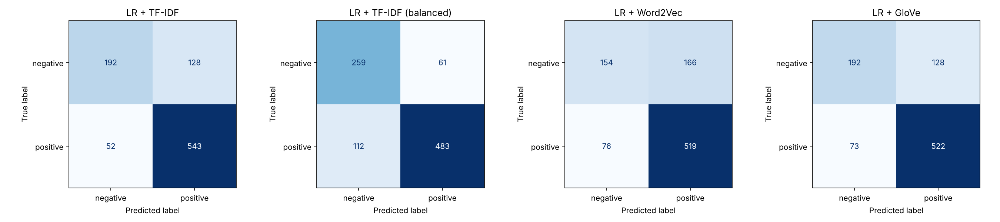
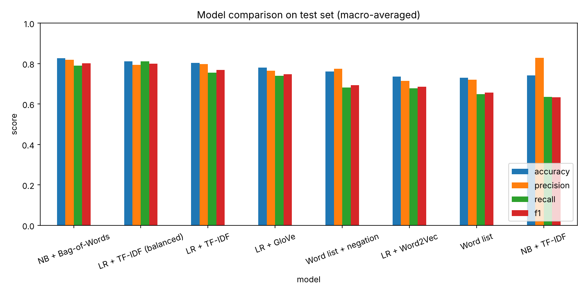

# Write-up: updated sections

Results are from `03_logreg_embeddings.ipynb` and `04_compare.ipynb`. Every number below comes from `results_01.csv`, `results_02.csv` and `results_03.csv`.

---

## 3. Logistic Regression with TF-IDF and Word Embeddings

We trained Logistic Regression on four feature sets. The first two use TF-IDF. One is the default model. The other sets `class_weight="balanced"`, which makes each negative sentence count about twice as much during training to make up for the 65/35 imbalance. The last two use word embeddings: each sentence becomes the average of its word vectors. For Word2Vec we trained 100-dimensional vectors on our 3,659 training sentences. For GloVe we used pre-trained 100-dimensional vectors (glove-wiki-gigaword-100, 400,000 words).

| Model | Accuracy | Macro precision | Macro recall | Macro F1 |
|---|---|---|---|---|
| LR + TF-IDF | 80.3% | 0.798 | 0.756 | 0.769 |
| LR + TF-IDF (balanced) | 81.1% | 0.793 | 0.811 | 0.799 |
| LR + GloVe | 78.0% | 0.764 | 0.739 | 0.747 |
| LR + Word2Vec | 73.6% | 0.714 | 0.677 | 0.685 |

TF-IDF works much better with Logistic Regression than it did with Naive Bayes (macro F1 0.769 against 0.633). Logistic Regression learns its own weight for each word, so the smaller TF-IDF values do not push it toward the majority class the way they push Naive Bayes. The default model still favors positive sentences: it labels 543 of 595 positive sentences correctly (91%) but only 192 of 320 negative ones (60%). The balanced version shifts that trade-off. It catches 259 of 320 negative sentences (81%), the highest negative recall of any model we tested. In exchange, it labels 112 positive sentences as negative, up from 52. Its accuracy also rises to 81.1% and its macro F1 to 0.799.

The words with the largest weights make sense. The most positive are "great", "easy", "good", "excellent", "love" and "nice". The most negative are "not", "only", "poor", "unfortunately", "bad", "useless", "flaw", "problem" and "slow". Some product words, such as "camera", "price" and "features", also get positive weights. This means the model has picked up which topics reviewers tend to praise, not only opinion words.

The word embeddings did not beat TF-IDF. GloVe reached 78.0% accuracy and 0.747 macro F1. Word2Vec reached 73.6% and 0.685. Both mislabel many negative sentences as positive (128 with GloVe and 166 with Word2Vec, out of 320; Figure 3). We see two reasons:

1. Averaging the word vectors throws away word order and blurs negation, so "not good" ends up close to "good". Opposite words like "good" and "bad" also appear in similar contexts, so their GloVe vectors are close together. A single averaged vector therefore carries a weak sentiment signal.
2. Word2Vec only had 3,659 short sentences to learn from. That is too little text to learn good vectors, which is why the pre-trained GloVe vectors did clearly better.

*Figure 3: Confusion matrices for Logistic Regression with TF-IDF, balanced TF-IDF, Word2Vec and GloVe features on the test set.*

---

## Comparison

| Rank | Model | Accuracy | Macro F1 | Negative recall |
|---|---|---|---|---|
| 1 | Naive Bayes + Bag-of-Words | 82.6% | 0.801 | 67% |
| 2 | LR + TF-IDF (balanced) | 81.1% | 0.799 | 81% |
| 3 | LR + TF-IDF | 80.3% | 0.769 | 60% |
| 4 | LR + GloVe | 78.0% | 0.747 | 60% |
| 5 | Word list + negation | 76.0% | 0.693 | 42% |
| 6 | LR + Word2Vec | 73.6% | 0.685 | 48% |
| 7 | Word list | 72.9% | 0.656 | 38% |
| 8 | Naive Bayes + TF-IDF | 74.2% | 0.633 | 28% |

*Figure 4: Accuracy and macro-averaged precision, recall and F1 for every model on the same 915-sentence test set.*

Naive Bayes with bag-of-words and balanced Logistic Regression with TF-IDF are effectively tied as our best models (macro F1 0.801 against 0.799). A gap that small could easily come from a different random train/test split. They make different mistakes, though. Naive Bayes has higher accuracy but misses a third of negative sentences. Balanced Logistic Regression catches 81% of negative sentences but mislabels more positive ones. If finding complaints matters most, which is often the point of review analysis, balanced Logistic Regression is the better choice.

Our main findings:

- **Machine learning beats the word list.** Most trained models beat the word-list baseline with negation handling (0.693). The two exceptions are Word2Vec (0.685) and Naive Bayes with TF-IDF (0.633). Learning from labeled data lets a model pick up complaints that contain no opinion words, which was the word list's biggest source of errors.
- **The right features depend on the model.** TF-IDF hurt Naive Bayes but worked well with Logistic Regression. Plain word counts suited Naive Bayes best.
- **Averaged embeddings did not help.** On short review sentences, simple word-based features (bag-of-words and TF-IDF) did better than averaged GloVe or Word2Vec vectors. Pre-trained GloVe clearly beat Word2Vec trained on our small dataset.
- **Class imbalance matters more than accuracy shows.** Every model does better on positive sentences. Balancing the class weights was the most effective single change we made for catching negative sentences.

---

## Challenges (add to the existing paragraph)

For the embedding models, the pre-trained GloVe vectors are a 128 MB download the first time the notebook runs, so the first run is slower. We also found that the class imbalance made every model favor positive sentences. To address this, we tested Logistic Regression with balanced class weights, which raised negative recall from 60% to 81%.
